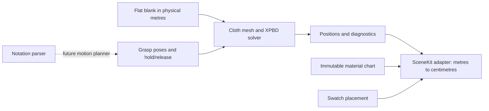

# Cloth lab mechanics — 0.5 milestone

The deliverable is a controlled, uncalibrated cloth experiment and an experimental four-in-hand relaxation seed. It is not a completed tying simulator. Keep the authored view and the 0.3.1 checkpoint available for comparison.

The current acceptance and failure handling are specified in `COLLISION-ACCEPTANCE.md`. The 0.4 package and its verification record remain preserved; the current solver no longer publishes that revision's invalid knot trial.

## Boundaries and units

The core has no AppKit, SceneKit or notation dependency. Rest coordinates are two-dimensional **physical metres**, across and along a flat, tapered strip. The flat TieBlank assumption supplies width; authored compressed width and normalized texture UVs never define the rest metric. Rendering derives texture UVs from the immutable chart in centimetres. Changing a swatch does not change mechanics.

Each triangle uses its flat rest matrix to compute deformation-gradient columns. XPBD solves separate longitudinal (warp) stretch, transverse (weft) stretch and normalized shear. Area scaling gives membrane stiffness units of N/m. Hinges between triangles use a signed dihedral angle and geometric weight, with bending stiffness in N·m. Lumped mass comes from rest area and areal density. Velocity comes from corrected displacement. These are mechanical constraints, not positional smoothing or attraction to the authored surface.

Use fixed small substeps, resetting constraint multipliers per substep and accumulating them over iterations. The implementation follows [XPBD](https://mmacklin.com/xpbd.pdf), the material-frame gradients in [Strain Based Dynamics](https://matthias-research.github.io/pages/publications/strainBasedDynamics.pdf), and the small-step approach in [Small Steps](https://mmacklin.com/smallsteps.pdf). Parameters are illustrative; no silk/lining measurements have been fitted.

Defaults: areal density 0.30 kg/m²; warp/weft/shear stiffness 1800/1200/600 N/m; bending stiffness 0.00002 N·m; gravity 9.81 m/s²; mid-surface contact separation 0.5 mm; external friction coefficient 0.35. The strip uses six substeps per 1/60 s frame, eight iterations, and damping 0.8/s. The compressed knot seed uses twelve substeps and strong damping 80/s for relaxation. This is not calibrated real-time cloth dynamics. Larger substep counts alone did not resolve the seed's instability; the probe records rejected configurations.

## Contact and limits

Rounded-support and floor contact, plus vertex–triangle and edge–edge self-contact, use a finite separation distance. A spatial hash bounds response candidates. Physical rest-distance exclusions replace the overly broad one-ring response exclusion. External contact supports a Coulomb-limited tangential correction; self-contact friction is omitted. Old-side contact planes also restrict closing displacement at existing contacts.

The response is discrete. A separate **swept acceptance guard** checks proposed linear motion, finite separation and triangle collapse; exhausted or unresolved checks reject the frame. Finite triangle interiors against capsule supports are included; shared-vertex triangle pairs remain outside its scope, and double-precision bounds are not a formal proof. Unlike [C-IPC](https://ipc-sim.github.io/C-IPC/), this is not an intersection-free barrier method. Passing proximity tests are not a topology certificate.

## Controls and sequence work

The lab starts paused. Run/Pause, one-frame Step, Reset, held-end movement and hold/release operate through a solver controller on a serial worker queue. Reset discards pending results by generation. A nonfinite or excessive-speed step rolls back and pauses with a visible error. Snapshots return to the main thread; SceneKit only displays them.

The first case is a tapered strip draped over a capsule. Its material chart is a 36 cm slice of the assumed blank. The folded-strip benchmark drops a free layer onto held cloth; it uses bending stiffness 0.000002 N·m, damping 8/s and twelve base substeps. The third case samples the authored four-in-hand, refines intersecting regions and prepares contact clearance while preserving its rest chart. It still has substantial compression and shear and cannot advance safely. It is not a tying sequence.

Material corrections use a 0.25-local-rest-edge trust region, applied equally to position and multiplier increments. These finite-iteration choices affect convergence and are not fitted material data. Acceptance can double the substep count up to three times within its work budget. See the timestep measurements in `CLOTH-VERIFICATION.md`.

A grasp command contains vertex-patch membership, position, orientation and hold/release, separate from the notation parser. A real tying controller additionally needs slack, collision-aware paths, and explicit identification of the loop used by T. FM notation alone does not provide these. Revisit resolution, calibrated stiffness, swept contact, self friction and a motion planner before claiming arbitrary knots or accurate final pattern placement.

## Verification contract

Test rest/rigid invariance, analytic gradients against finite differences, isolated warp/weft/shear, bending with little intrinsic strain, fixed-step sensitivity, external and self-contact thickness, edge crossings, friction limits, a known tunnelling case, reset determinism and immutable chart coordinates. Retain numerical outputs and windowless renders. Live interaction and Gatekeeper remain unverified in this environment.
