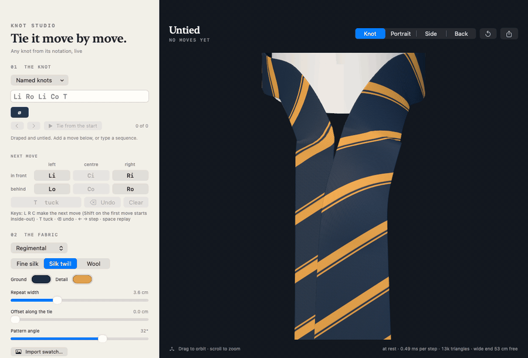
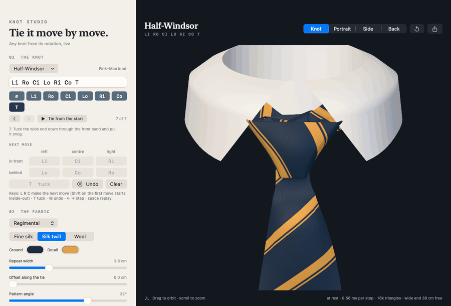
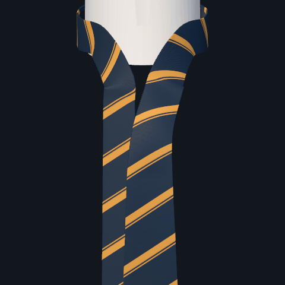
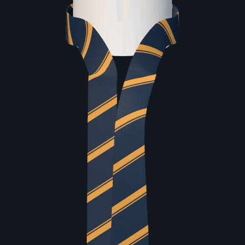
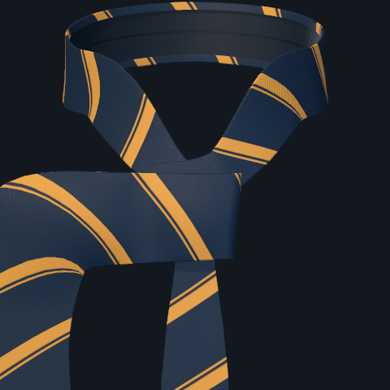
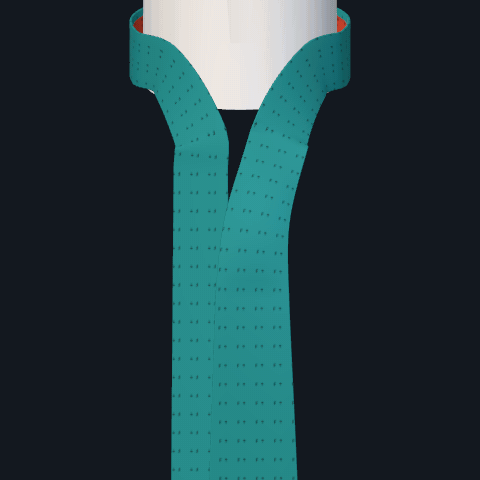
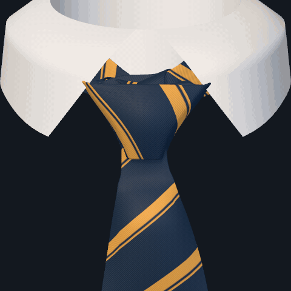
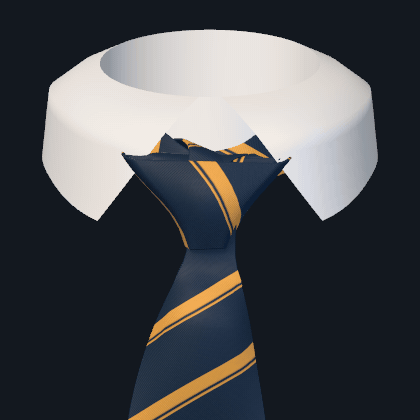

# Knot Studio 1.0 — live tie knots from notation

A native macOS app (SwiftUI + SceneKit) that ties any necktie knot from its Fink–Mao notation, in real time, one move at a time. Type `Li Ro Li Co T`, press the move buttons, or scrub through a named knot and watch the wide end go across, behind, over the top and through.



Typing a sequence ties it as you go; half-typed text shows the knot so far and says what is missing:


Cloth, pattern, the front/back faces view, and stepping back through the timeline:



Close-ups of the model:

| Four-in-hand | Windsor | The tuck |
| --- | --- | --- |
|  |  |  |

| Inside-out start (Pratt), faces view | Cloth weight | All round |
| --- | --- | --- |
|  |  |  |

It replaces the earlier approach (hand-authored presets plus a physical cloth solver), which is kept untouched in [Legacy/](Legacy/README.md).

## Run

Requires Apple Silicon, macOS 13+, and the command-line Swift toolchain.

```sh
zsh Scripts/build.sh
```

```sh
open build/KnotStudio.app
```

## Use

- **Notation field** — any sequence of `Li Lo Ri Ro Ci Co`, optionally ending in `T`. Case, spaces and `⊗/⊙` are accepted. Text that is only partly valid still shows the knot up to the last valid move, with a note about what is wrong.
- **Next move** — the six move buttons and `T`; only moves that can legally follow are enabled. Undo and Clear step back.
- **Finishing** — `T` threads the wide end: it stays up where it came through the neck loop, its tip is turned forward and fed down under the front band, and the cloth is drawn through. The knot then cinches into its dressed shape, rises to the collar, and the collar folds down. Lower Tightness to open it back up and see the structure.
- **Keys** — `L` `R` `C` make the next move into that region (its direction is forced by the alternation rule; on the first move, Shift starts inside-out). `T` tucks, Delete undoes, ←/→ step, Space replays. Return or Escape leaves the notation field.
- **Timeline** — one chip per move. Click a chip to show the knot as it stands after that move; `∅` is the untied tie. “Tie from the start” replays the whole sequence.
- **Named knots** — the fourteen named Fink–Mao knots. Sequences outside the classical rules (other endings, first move to the right, more than nine moves) work too and are labelled off-catalogue.
- **Fabric** — stripes, dots, windowpane, solid, or an imported swatch, with repeat width, offset and angle measured on the flat cloth. Cloth is fine silk, silk twill or wool: each has its own weave and sheen, and its thickness sets the bulk of the knot, so the same moves tie a bigger knot in wool. The back of the tie shows its lining, centre seam, keeper loop and label.
- **Look closer** — a shirt collar (on by default), tightness, layer separation (pulls the stack apart to read the overlaps), tying speed, and two diagnostics: Grid (the cloth’s own coordinates) and Faces (teal = front of the fabric, rust = back).

The view is the mirror view of the notation papers: narrow end on the left; a move is named for the region the wide end arrives in and where it points next (`i` into the shirt, so it was laid across the front; `o` out of the shirt, so it passed behind).

## How it works

See [docs/MODEL.md](docs/MODEL.md). In short: the notation fixes how the wide end winds around the narrow end, so the knot is built directly as a ribbon folded around a flat core. Each move is a flat panel of cloth, each turn a roll around a straight crease, and later panels always lie outside earlier ones. That gives correct overlaps and undistorted pattern placement without collision detection. Only the free wide end is simulated (a short particle chain). A step, including re-meshing, costs about 0.4 ms.

It shows structure, overlap and pattern. It does not predict how a particular cloth drapes or bunches.

## Layout

| Path | What |
| --- | --- |
| `Sources/KnotEngine` | Notation, layout, folded path, free-end chain, mesh. Foundation + simd only. |
| `Sources/KnotStudio` | The app: SceneKit scene, fabric textures, SwiftUI interface. |
| `Tests/Checks.swift` | Engine checks (see below). |
| `Tools/Render.swift`, `Tools/contact_sheet.py` | Offscreen renders for looking at the model without opening the app. |
| `Legacy/` | The 0.8 preset studio and cloth lab, with their own scripts, tests and deliverables. |

## Check

```sh
zsh Scripts/test.sh
```

Checks the notation rules (including that they enumerate exactly the 85 Fink–Mao knots), then builds every one of those knots at every step of tying — 854 states — and verifies that each move crosses the strand the notation says it crosses and on the right side, that layers stack in order, that the tuck sits under its band, that folds are true reflections and that the cloth is not stretched. It also ties and unties a Windsor live and times the step.

```sh
zsh Scripts/render.sh artifacts/windsor.png "Li Co Ri Lo Ci Ro Li Co T" view=knot
```

Options: `cloth=finesilk|silktwill|wool`, `collar=off`, `steps=N`, `view=knot|portrait|side|back`, `display=fabric|grid|faces`, `tight=0…1`, `spread=`, `zoom=`, `size=`, and `from=<notation> animate=<seconds>` to catch a frame in mid-move.

```sh
build/KnotStudio.app/Contents/MacOS/KnotStudio --selftest "$PWD/artifacts/selftest"
```

Runs the real app through a short tying session, saves what the view shows at each stage and writes frame timings to `selftest.txt`.

```sh
zsh Scripts/gifs.sh
```

Re-renders the GIFs above into `docs/media` (needs ffmpeg). The interface ones come from `KnotStudio --record <dir>`, which plays scripted sessions in the real window on a fixed clock and saves every frame.

## Known limits

- Folds are sharp creases and panels are flat; the cushioning, taper and dimple are shaping applied afterwards. Real knots bunch and wrinkle.
- While a move is in progress the wide end is led straight along its direction of travel and then released; it does not model a hand. The threaded tuck is a drawn path, not a simulation.
- The collar is a plain shape with no shirt; while tying it stands up, which fills the background of the close view.
- A finished knot is dressed by rule (folds drawn in, band raised to cover the top, taper from the knot’s bulk), not by solving for tension. From above it is an open cup.
- Only the classical final tuck is supported, by choice: knots that tuck under earlier bands are out of scope.

## Licence

MIT — see [LICENSE](LICENSE).
